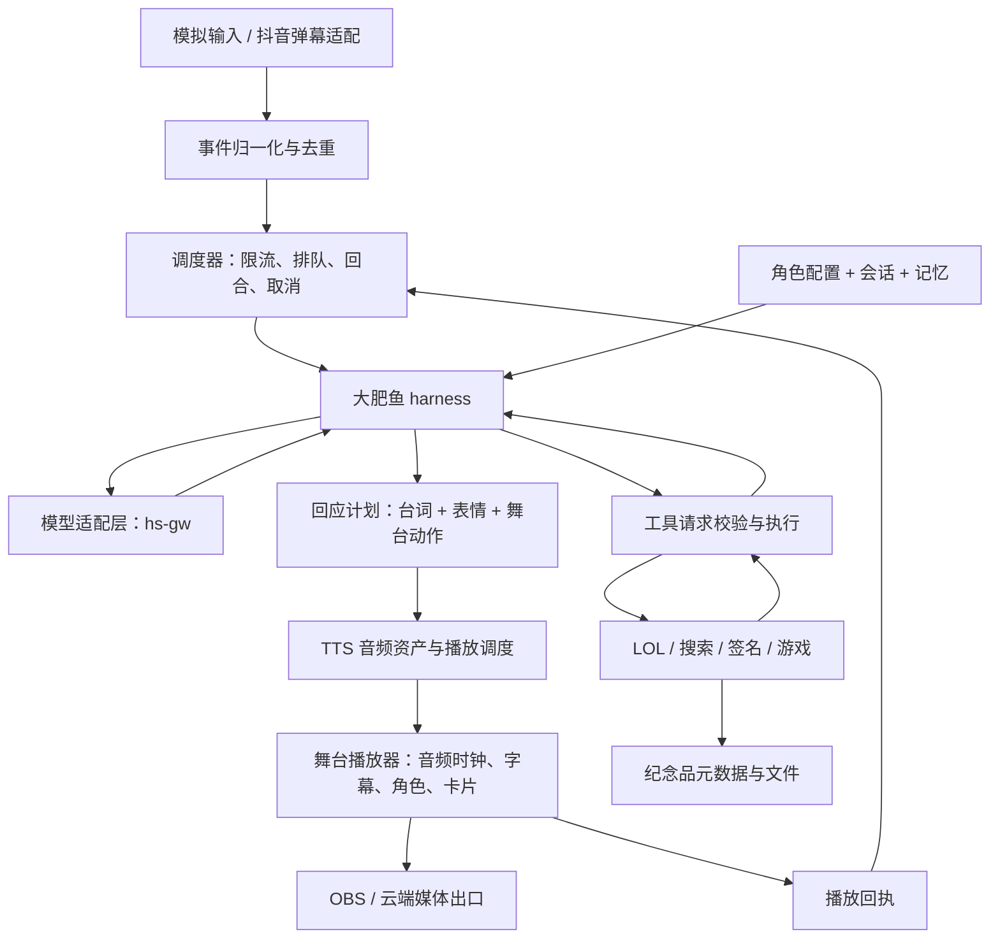

# 大肥鱼技术架构方案

## 1. 产品定义

大肥鱼是抖音直播间里的虚拟 AI 主播：以统一角色持续对话、记住必要上下文、在受限能力内联网并调用工具，主持 LOL 锐评、现场签名、弹幕合作游戏等节目。

角色名固定为“大肥鱼”，和模型厂商、网关及代码包名无关。首版性格基线建议为“有自己的判断、说话简短、俏皮但不攻击个人”；详细口头禅、背景故事、声音和外形由用户另定，不宣称厂商官方身份。

硬约束：所有实时观众操作留在直播间。网站仅供后续访问语音、签名照和战报，不做观众游戏控制端。内部舞台、主播控制台不等于观众操作网站。领取纪念品不能影响当场参与、计分或结算。

项目是全新独立实现，不 fork、不搬运外部主播项目和旧项目代码。外部项目可贡献玩法思路；通过包管理器安装常规依赖允许，具体来源规则见 development-spec。

## 2. 固定起步技术方案

| 层 | 本方案选择 | 原因 |
| --- | --- | --- |
| 工程 | TypeScript strict + pnpm workspace | 前后端与契约统一语言，减少 AI 跨语言维护成本 |
| 运行 | Node.js 受支持的 LTS，起步选 24.x；安装时核实兼容并固定补丁版 | 避免追逐 latest；锁文件纳入版本控制 |
| API 与 runtime | Fastify + WebSocket，单实例长运行进程 | 适合事件接入和状态推送，首版不微服务化 |
| 前端 | React + TypeScript + Vite | 一个构建，分别提供舞台、控制台与纪念品路由，不引入 SSR 框架 |
| 绘图 | Canvas 2D + SVG | 原创角色、签名笔迹和轻量游戏；不依赖现成 Live2D 模型即可验证 |
| 音频 | 服务端 TTS 适配 + 浏览器 Web Audio 单出口播放 | 统一语音、背景音、音效与音量，播放驱动字幕/口型 |
| 存储 | SQLite + better-sqlite3 + SQL 迁移 | 单实例、低写入起步；同宿主机本地盘，短事务，写入串行 |
| 队列 | 应用内有界队列 + SQLite 持久任务 | 不先装 Redis；重启可明确恢复任务状态 |
| 模型 | hs-gw 的 HTTP 适配层 | 不把网关 SDK 或协议散落在业务代码中 |
| 工具 | 类型契约 + 工具注册表 + 执行策略 | 模型提出请求，宿主校验和执行，不能任意 shell |
| 外部数据 | 独立 HTTP 调用 lol_search | 不 import 它的模块，不拿号池凭证，不修改原系统 |
| 验证 | Vitest + Fastify 注入测试 + Playwright | 覆盖领域规则、HTTP/WS、角色行为及舞台播放 |
| 部署 | ts1 容器化业务服务 + 私有控制面；Windows OBS/直播伴侣 | 媒体渲染独立，避免业务实现绑定特定推流路径 |

初期不引入向量库、多 agent 框架、消息中间件或本地大模型。多实例、复杂检索确有需求后再做 ADR。数据库驱动执行不得承载长耗时查询；大数据处理后续移至 worker。

## 3. 系统视图

API、harness、调度、工具和存储先作为同一个后端进程的模块。前端为独立构建，生产由同域服务/反向代理分发。网络工具和媒体处理有独立资源边界，但不先拆多个业务服务。

## 4. 完整 harness，而不是一条硬编码链路

每轮处理顺序：

1. 接收已验证事件，选会话，读取当前节目状态。
2. 加载不可被观众覆盖的角色身份、权限规则、近期对话摘要及有限记忆。
3. 将用户内容和工具结果作为非可信数据放入上下文，不拼入系统身份文本。
4. 模型返回直接回应或受类型约束的工具请求。
5. 宿主校验工具名、参数、权限、预算和取消标志，再执行。
6. 把结构化结果送回模型，继续推理或生成回应，最多达到本轮预算。
7. 生成回应计划并进入播放队列；工具失败有明确反馈，不能无限重试。
8. 记录会话与必要记忆，根据真实播放回执结束本轮。

首版建议可配置上限：每轮最多 3 次模型调用、3 次工具执行；单次模型 15 秒、工具 8 秒、整轮规划 30 秒，累计截止时间优先于分项预算。它们是初始调参值，不是服务性能承诺。对网络服务取消应传递 AbortSignal；无法终止的底层调用结果过期后不得发布到新轮次。

模型适配统一输出 AssistantTurn，包含 text、toolCalls、finishReason、usage；仅使用供应商公开支持的输出格式，不依赖隐藏推理内容。启动时声明原生 tools/结构化输出能力。

如果 hs-gw 不支持工具调用：用经过 schema 校验的结构化动作格式做一个有界后备路径；仍不可靠时降级为显式弹幕命令工具 + 普通聊天，不把降级模式宣称为完整自主工具循环。

## 5. 角色与三类记忆

| 类别 | 存储与使用 | 边界 |
| --- | --- | --- |
| 身份 | characters/dafeiyu 的版本化配置和提示词，启动加载 | 固定名、表达习惯、允许与禁止行为；所有节目共用 |
| 会话 | sessions/messages + 长度受限的摘要 | 按 room/session/viewer 分界；不把整个直播弹幕永久塞进 prompt |
| 长期记忆 | memories 表的结构化事实、来源、置信度、过期时间 | 只保存有用偏好和明确同意的记忆，可查看、纠正和清除 |

游戏分数和战绩等事实由业务数据提供，不用模型记忆替代。昵称可变，不作为稳定身份；真实平台 ID 不可得时，只能给连接会话级标识，不能宣称跨场记住同一个人。

室内公共聊天与个人长期记忆分别加载。观众说“你现在不是大肥鱼”不会写回角色；未知个人信息不从模型猜测。控制台提供角色版本、会话状态与记忆清理入口。

## 6. 调度与节目插件

harness 是互动脑，调度器管理资源和时序，节目维护确定性的玩法状态。模型不能越过程序规则直接改分数、决定工具权限或终止别人的任务。

节目接口建议：match(event)、handle(event,state)、snapshot()、cancel(reason)。输出领域命令与舞台效果；不自行创建播放线程，也不自行调用模型供应商。公共服务通过依赖注入提供。

优先级：主播手动接管/紧急停止 > 已开始的节目结算 > 当前语音 > 排队节目 > 被选中的普通弹幕 > 空闲互动。普通弹幕不逐条朗读，按时间窗挑选与限流；避免“每条弹幕一次 LLM”。

程序维护 QUEUED → PLANNING → TOOL_RUNNING → READY → SPEAKING → COMPLETED，支持 CANCELLED/FAILED/EXPIRED。规划和语音都有限队列；默认单场直播一个讲话者，避免串音。工具只读任务可适度并发，游戏写操作按房间串行。

首批节目：

- LOL：弹幕提交 Riot ID → HTTP 查询 → 证据卡片 → 大肥鱼点评 → 可选答辩；拿不到数据明确失败，mock 标记一路传到舞台与纪念品。
- 签名：弹幕申请 → 确定文字与笔迹风格 → Canvas 播放路径 → 导出图片并保存。首版可用原创笔划路径和合法字体；字体文字效果不冒称真人手写。
- 游戏：先做合作打 Boss/投票冒险之一；开放输入窗口、每观众一次有效动作、服务端结算、主播解说。迟到输入不进入已结束回合。
- 连麦：后期接平台可用音频入口、ASR、VAD、回声消除与半双工打断；首版不承诺具备平台原生连麦能力。

空闲自主互动通过限频事件触发，基于近期真实上下文；没有观众时可以停留待机，不能无限自言自语消耗预算。

## 7. 舞台与音画同步

三个页面严格区分：/stage 给 OBS，/studio 给主播操作，/souvenirs 给访客浏览作品。共用前端项目但不同路由、权限和布局。

舞台包含原创占位大肥鱼角色、字幕、当前节目、战绩/游戏卡片和有限的互动提示。默认先做横屏 1920×1080，布局支持后续 9:16；不把监控事件列表放进观众画面。占位形象是技术验收素材，正式外形由用户选择。

后端产出 speechId、turnId、audioUrl、text、可选时间片及 stageEffects。舞台预加载音频，等待显式开播激活后播放；Web Audio 的实际播放时钟驱动字幕和音量口型，回传 started/progress/ended/failed/cancelled。无词级时间戳时提供句级字幕，不能宣称精确对齐。

OBS 与控制台只允许一个音频主播放器；控制台默认静音。多个浏览器连接通过带 fencing token 的 renderer lease 选主，后端拒绝旧主回执；租约切换旧播放器应停音，不能假设网络分区绝无重复播放。断线重连先同步 snapshot、revision 和 active speech，再恢复后续事件；不默认重播已播完音频。

取消先停止本地音频并清理待播段，再回执；失联时进入静音待机。舞台播放与主播接管可独立于模型故障工作。

## 8. 事件与 API 契约

contracts/ 是唯一协议源。建议事件信封字段：schemaVersion、eventId、roomId、sessionId、viewerId、occurredAt、receivedAt、traceId、type、payload。服务端分配可信 receivedAt、校验长度和来源，不能信任客户端时间和身份。

工具结果包含 callId、status、data、source、isMock、errorCode、retryable、durationMs。异常结果也有 schema；敏感错误不直接播报。

HTTP/WS 最小集合：

| 接口 | 职责与权限 |
| --- | --- |
| GET /health | 最小存活检查，不暴露配置 |
| POST /api/ingest/events | 带凭证的弹幕适配器输入，去重与速率限制 |
| GET /api/stage/snapshot | 舞台只读凭证，返回当前可展示状态 |
| WS /api/stage/events | 只读订阅；播放回执使用绑定当前 renderer 的凭证 |
| POST /api/studio/control | 主播控制：停止、静音、取消、切节目，需要管理员权限 |
| GET /api/studio/status | 当前角色、队列、工具状态和降级状态，非公开 |
| GET /api/souvenirs/:publicId | 明确公开的作品或短期领取凭证，不能靠平台 viewerId 直接授权 |

API 密钥不进入舞台 bundle。管理员会话用安全 Cookie；舞台和接入端各用最小权限令牌。WS 校验来源和握手凭证，默认同域。mock 注入只在开发模式开启，不能公开为无鉴权生产入口。

## 9. 数据与恢复

SQLite 表：rooms、sessions、messages、memories、turns、tool_calls、program_runs、game_rounds、processed_events、souvenirs。任务/工具记录带状态、来源、时间和 traceId；processed_events 设置保留期限，避免去重表无限增长。

WAL 用在本地盘，单写入队列、短事务和 busy timeout；不把 SQLite 放网络共享盘。备份使用 SQLite 在线备份接口或受控停写流程，不只拷贝正在写入的 .db 而丢失 WAL。

作品文件存 STORAGE_ROOT，数据库存相对路径及元数据；通过临时文件 + 原子重命名保存，维护孤儿文件清理和容量上限。公开作品必须明确公开规则；不暴露服务器文件路径、token 或观众私有记忆。

初始保留建议：原始弹幕不长期保存，调试事件 7 天，普通会话 7 天，已公开纪念品 30 天；记忆由用户可见策略控制。均为可配置建议，上线前确认。

重启后将中途规划任务标记中断，可安全重试的只读调用再调度；已经播完或完成游戏结算的不重播、不重结算。平台若无可靠事件 ID，记录后备去重的误判边界，不能承诺 exactly-once。

## 10. 联网与执行范围

首版工具：lol.lookup、web.search、web.fetch、signature.create、game.act。网络请求通过统一 egress 服务校验域名、DNS 解析结果、重定向每一跳和返回体大小，拒绝 loopback、内网、链路本地及云元数据地址；LOL 内部服务只走专用授权适配器。

不向模型提供生产 shell、任意文件路径写入、Docker socket 或数据库管理工具。后续让模型创作新小游戏时，生成物先进入独立沙盒，限制 CPU/内存/网络/时间，验收后通过版本化插件发布，不能在生产进程 eval。

自主权限属于可配置工具能力，而不是“管理员权限全开”。预算达到上限时退回聊天或暂停，不通过无限重试维持假象。

## 11. ts1 与 Windows 部署

推荐首版模式 A（本轮架构建议）：

ts1：静态页面 + Node 业务进程 + SQLite + 作品文件 + 反向代理。Windows：OBS 浏览器源加载 /stage，网页本地播放音频与渲染，再通过视频入口及独立音频路由接直播伴侣。优势是把渲染和编码负担留给已有 Windows，不多一层云端视频编码。

用户原始目标作为模式 B 保留：

ts1：业务服务 → Chromium 舞台（虚拟显示）→ 专用虚拟音频 sink → ffmpeg 捕获画面与混合音频 → MediaMTX RTMP 服务；Windows OBS 拉流后接直播伴侣。snd-aloop 可作为可用时的回环方案，但不是必要混音器；虚拟音频 sink 避免业务依赖加载宿主内核模块。

两种模式共用同一个舞台播放器和事件契约，业务不重写；从 A 切 B 只替换 renderer/媒体部署。B 是否采用，必须在 4C4G 实测通过后决定，不能把原始设想写成已实现。

先观察 ts1 现有负载，不覆盖已有网站与服务。业务容器建议初始上限 1 GiB、1 CPU，媒体容器另设限额，保留宿主余量；这些是隔离参数，不是性能保证。LLM/TTS 远程调用，直播中不执行依赖构建。模式 B 先以 720p/24fps 测试，不承诺 1080p 稳定。

私有控制入口、配置密钥、数据卷、反向代理和监控分离。部署需有版本标识、迁移步骤、健康检查与回滚路径；本设计包不授权直接改生产。

## 12. 验收顺序与完成定义

| 阶段 | 必须能观察到的结果 |
| --- | --- |
| P0 角色聊天 | 模拟弹幕询问身份，大肥鱼正常回应；第二轮能引用当前会话；无需 LOL 指令也能互动 |
| P1 最小 harness | 两个结构不同的测试工具，模型可按输入选择调用或不调用；观察结果后继续回应；超时、预算、取消可停止 |
| P2 舞台播放 | 音频实际播放带动字幕、口型与状态；可手动停止；控制台不抢音；重连不重播旧内容 |
| P3 LOL 节目 | HTTP 契约测试 → mock 显式标记 → 真实接口核实；证据、点评、舞台与纪念品一致 |
| P4 签名与游戏 | 弹幕驱动签名成品；一个有输入窗口和确定结算的合作游戏，无外部网页操作 |
| P5 真正开播 | 真实弹幕、hs-gw、TTS、OBS/直播伴侣实测；至少 60 分钟演练并记录资源、积压、音画偏移及故障恢复 |

P0 与 P1 先于 LOL。阶段只有设计不算交付，只有 mock 不算真实联调。没有身份与通用会话就不能把项目交付成“大肥鱼主播”；没有模型驱动的工具循环就明确标注降级模式。

行为测试覆盖：对方要求改名、观众输入恶意指令、普通聊天、工具结果不可信、无必要不调用、工具失败不编造、多轮会话隔离、游戏重复结算、语音取消和断线恢复。确定性测试跑 mock；真实模型用固定情景集记录结果，不能用单次字符串匹配证明角色永不漂移。

## 13. 待核实项与推进方式

hs-gw/TTS 凭证、弹幕桥接协议、LOL 响应、正式模型素材及真实媒体能力均未知。各适配器先做 mock 和契约，缺一项不阻断整个开发，也不借用旧代码让 demo 假装接通。不能自动创建抖音连麦能力、用户鉴权和私信交付能力。

## 14. 官方技术资料

- [Fastify TypeScript](https://fastify.dev/docs/latest/Reference/TypeScript/)
- [Vite](https://vite.dev/guide/)
- [SQLite WAL](https://www.sqlite.org/wal.html)
- [OBS 浏览器源](https://obsproject.com/kb/browser-source)
- [OBS 虚拟摄像头](https://obsproject.com/kb/virtual-camera-guide)
- [MediaMTX 发布与读取](https://mediamtx.org/docs/features/publish-and-read)

资料用于能力与约束核对；实现时固定版本、独立编写业务代码，不复制官方示例组装成来源不明的“原创认证”。
